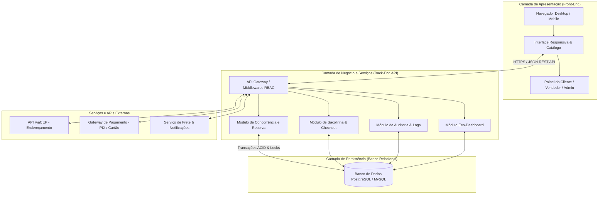
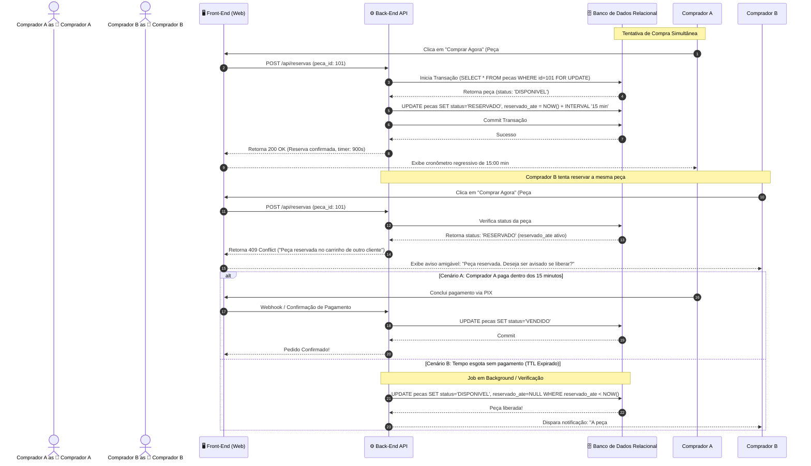
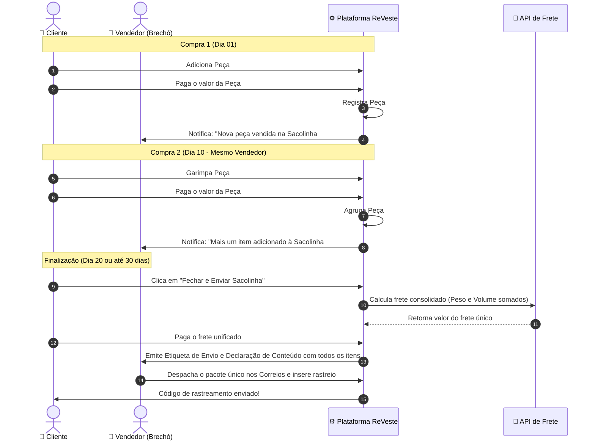
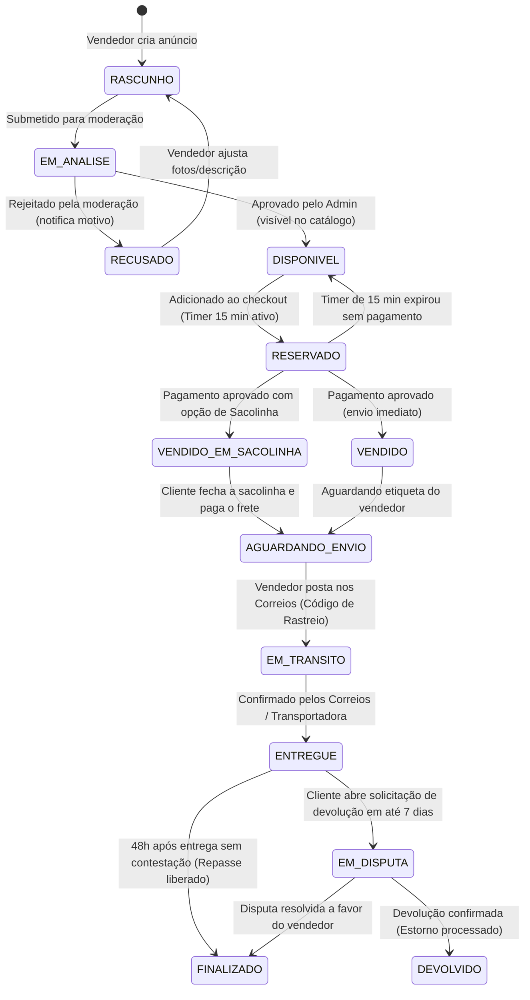
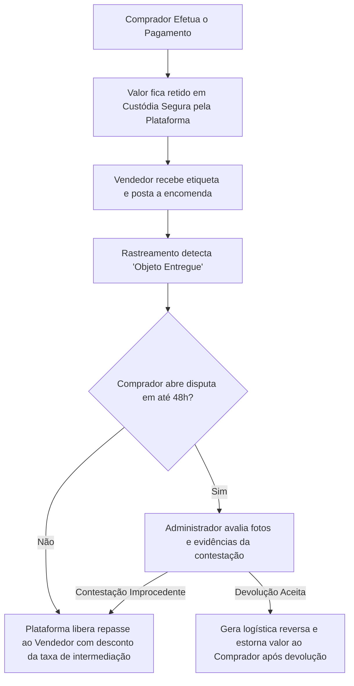

# 📐 Arquitetura de Software e Fluxos Transacionais — ReVeste

> **Documento Técnico de Engenharia: Diagramas de Sequência, Máquina de Estados e Fluxos de Concorrência**  
> *Projeto Integrador II — ReVeste: Brechó Digital*

[ ⬅️ Voltar à Central de Documentação ](./README.md)

---

## 🏛️ 1. Arquitetura Geral da Solução

O ReVeste adota uma arquitetura em camadas desacopladas (**Client-Server RESTful**), orientada a transações seguras e consistência de dados:

---

## ⏱️ 2. Fluxo de Reserva Concorrencial de Peça Única (Anti-Overselling)

Por se tratar de **SKU de unidade única**, duas pessoas não podem comprar a mesma peça. O fluxo a seguir detalha o mecanismo de lock e expiração por timer:

---

## 🛍️ 3. Fluxo de Consolidação de Frete: "Abrir Sacolinha"

A Sacolinha permite ao cliente acumular itens exclusivos do mesmo vendedor ao longo de até 30 dias para pagar um frete único:

---

## 🔄 4. Máquina de Estados: Ciclo de Vida da Peça de Brechó

Cada roupa física passa por um ciclo de vida rigorosamente controlado pelo sistema:

---

## 🛡️ 5. Fluxo de Custódia Financeira (*Escrow*) e Segurança

Para proteger ambas as partes nas transações de segunda mão:

