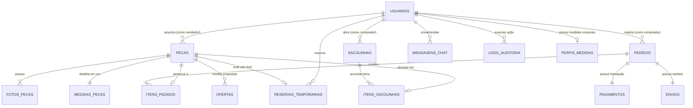

# 🗄️ Modelagem de Banco de Dados Relacional — ReVeste

> **Documento de Arquitetura de Dados: Diagrama Entidade-Relacionamento (DER), Dicionário de Dados e Trilha de Auditoria**  
> *Projeto Integrador II — ReVeste: Brechó Digital*

[ ⬅️ Voltar à Central de Documentação ](./README.md)

---

## 📊 1. Diagrama Entidade-Relacionamento (DER)

Abaixo está a representação conceitual e lógica do banco de dados relacional (PostgreSQL / MySQL) estruturado em conformidade com as regras de normalização e integridade referencial:

---

## 📋 2. Dicionário de Dados e Estrutura das Tabelas

### 2.1 Tabela: `usuarios`
Armazena todos os atores do sistema (Clientes, Vendedores e Administradores).

| Coluna | Tipo de Dado | Restrições | Descrição |
| :--- | :--- | :--- | :--- |
| `id` | SERIAL / UUID | PRIMARY KEY | Identificador único do usuário |
| `nome_completo` | VARCHAR(150) | NOT NULL | Nome civil completo |
| `email` | VARCHAR(120) | UNIQUE, NOT NULL | E-mail corporativo/pessoal |
| `senha_hash` | VARCHAR(255) | NOT NULL | Hash da senha (BCrypt salt 10+) |
| `cpf_cnpj` | VARCHAR(18) | UNIQUE, NOT NULL | Documento fiscal validado |
| `telefone` | VARCHAR(20) | NULL | Telefone para contato com DDD |
| `perfil_role` | ENUM | NOT NULL | `CLIENTE`, `VENDEDOR`, `ADMIN` |
| `nome_brecho` | VARCHAR(100) | NULL | Nome fantasia do brechó (se vendedor) |
| `bio_brecho` | TEXT | NULL | Descrição e história do brechó |
| `is_verificado` | BOOLEAN | DEFAULT FALSE | Selo de Vendedor Verificado pelo Admin |
| `cep` | VARCHAR(9) | NOT NULL | CEP residencial/comercial |
| `logradouro` | VARCHAR(150) | NOT NULL | Rua, Avenida, etc. (via ViaCEP) |
| `numero` | VARCHAR(20) | NOT NULL | Número do endereço |
| `complemento` | VARCHAR(100) | NULL | Apto, Bloco, etc. |
| `bairro` | VARCHAR(80) | NOT NULL | Bairro (via ViaCEP) |
| `cidade` | VARCHAR(100) | NOT NULL | Cidade (via ViaCEP) |
| `uf` | CHAR(2) | NOT NULL | Estado/UF (via ViaCEP) |
| `ativo` | BOOLEAN | DEFAULT TRUE | Status do cadastro do usuário |
| `criado_em` | TIMESTAMP | DEFAULT NOW() | Data e hora de criação |
| `atualizado_em` | TIMESTAMP | DEFAULT NOW() | Última atualização cadastral |

---

### 2.2 Tabela: `perfis_medidas`
Armazena a biometria corporal do comprador para uso no **Provador Virtual Inteligente**.

| Coluna | Tipo de Dado | Restrições | Descrição |
| :--- | :--- | :--- | :--- |
| `id` | SERIAL / UUID | PRIMARY KEY | Identificador único |
| `usuario_id` | INT / UUID | FK -> `usuarios(id)`, UNIQUE | Referência ao comprador |
| `busto_torax_cm` | DECIMAL(5,2) | NULL | Medida de busto/tórax em centímetros |
| `cintura_cm` | DECIMAL(5,2) | NULL | Medida de cintura em centímetros |
| `quadril_cm` | DECIMAL(5,2) | NULL | Medida de quadril em centímetros |
| `altura_cm` | INT | NULL | Altura em centímetros |
| `tamanho_habitual` | VARCHAR(10) | NULL | Tamanho que costuma usar (ex: M, 40) |

---

### 2.3 Tabela: `pecas` (O Núcleo da Peça Única / SKU Exclusivo)
Representa cada item físico único anunciado no brechó.

| Coluna | Tipo de Dado | Restrições | Descrição |
| :--- | :--- | :--- | :--- |
| `id` | SERIAL / UUID | PRIMARY KEY | Identificador único da peça |
| `vendedor_id` | INT / UUID | FK -> `usuarios(id)`, NOT NULL | Vendedor anunciante |
| `titulo` | VARCHAR(150) | NOT NULL | Título atrativo do anúncio |
| `descricao` | TEXT | NOT NULL | Descrição rica da peça |
| `categoria` | VARCHAR(50) | NOT NULL | Calças, Casacos, Vestidos, etc. |
| `genero` | ENUM | NOT NULL | `FEMININO`, `MASCULINO`, `UNISSEX`, `INFANTIL` |
| `tamanho_etiqueta` | VARCHAR(10) | NOT NULL | Tamanho que consta na etiqueta de fábrica |
| `estado_conservacao`| ENUM | NOT NULL | `NOVO_ETIQUETA`, `PERFEITO`, `USADO`, `VINTAGE` |
| `estilo_vibe` | VARCHAR(50) | NULL | Vintage Anos 80, Y2K, Streetwear, etc. |
| `tecido_composicao` | VARCHAR(100) | NULL | Algodão, Jeans, Linho, Couro, etc. |
| `marca` | VARCHAR(80) | NULL | Marca do fabricante original |
| `preco_anunciado` | DECIMAL(10,2) | NOT NULL | Valor de venda da peça |
| `permite_oferta` | BOOLEAN | DEFAULT TRUE | Se aceita propostas de desconto |
| `status` | ENUM | NOT NULL | `RASCUNHO`, `EM_ANALISE`, `DISPONIVEL`, `RESERVADO`, `VENDIDO`, `VENDIDO_EM_SACOLINHA`, `CANCELADO` |
| `agua_economizada_litros` | INT | NOT NULL | Fator de água poupada (ex: 8000 L) |
| `co2_evitado_kg` | DECIMAL(5,2) | NOT NULL | Fator de CO₂ evitado (ex: 13.5 kg) |
| `version` | INT | DEFAULT 1 | Controle de concorrência otimista (*Optimistic Lock*) |
| `criado_em` | TIMESTAMP | DEFAULT NOW() | Data do anúncio |

---

### 2.4 Tabela: `medidas_pecas`
Medidas reais tomadas com fita métrica pelo vendedor.

| Coluna | Tipo de Dado | Restrições | Descrição |
| :--- | :--- | :--- | :--- |
| `peca_id` | INT / UUID | PRIMARY KEY, FK -> `pecas(id)` | Referência à peça |
| `busto_cm` | DECIMAL(5,2) | NULL | Largura de busto em cm |
| `cintura_cm` | DECIMAL(5,2) | NULL | Largura de cintura em cm |
| `quadril_cm` | DECIMAL(5,2) | NULL | Largura de quadril em cm |
| `comprimento_total_cm` | DECIMAL(5,2) | NULL | Altura total da peça em cm |
| `ombro_a_ombro_cm` | DECIMAL(5,2) | NULL | Distância entre costuras do ombro |
| `manga_cm` | DECIMAL(5,2) | NULL | Comprimento da manga em cm |

---

### 2.5 Tabela: `fotos_pecas`
Galeria multimídia de cada produto com fotos de alta resolução e detalhes de desgaste.

| Coluna | Tipo de Dado | Restrições | Descrição |
| :--- | :--- | :--- | :--- |
| `id` | SERIAL / UUID | PRIMARY KEY | Identificador da foto |
| `peca_id` | INT / UUID | FK -> `pecas(id)`, NOT NULL | Peça proprietária |
| `url_imagem` | VARCHAR(255) | NOT NULL | Caminho da imagem (WebP/CDN) |
| `tipo_foto` | ENUM | NOT NULL | `FRENTE`, `COSTAS`, `ETIQUETA`, `DETALHE_DESGASTE`, `VIDEO_CAIMENTO` |
| `ordem_exibicao` | INT | DEFAULT 0 | Sequência no carrossel do anúncio |

---

### 2.6 Tabela: `reservas_temporarias` (Anti-Overselling)
Gerencia o bloqueio temporário de 15 minutos durante o fluxo de checkout.

| Coluna | Tipo de Dado | Restrições | Descrição |
| :--- | :--- | :--- | :--- |
| `id` | SERIAL / UUID | PRIMARY KEY | Identificador da reserva |
| `peca_id` | INT / UUID | FK -> `pecas(id)`, UNIQUE, NOT NULL | Peça bloqueada |
| `comprador_id` | INT / UUID | FK -> `usuarios(id)`, NOT NULL | Comprador com o lock ativo |
| `reservado_em` | TIMESTAMP | DEFAULT NOW() | Momento da entrada no checkout |
| `expira_em` | TIMESTAMP | NOT NULL | Momento de expiração (`NOW() + 15 min`) |
| `status_reserva`| ENUM | NOT NULL | `ATIVA`, `EXPIRADA`, `CONVERTIDA_EM_PEDIDO` |

---

### 2.7 Tabela: `sacolinhas` & `itens_sacolinhas`
Estrutura para o recurso de consolidação de frete em até 30 dias.

| Coluna | Tipo de Dado | Restrições | Descrição |
| :--- | :--- | :--- | :--- |
| `id` | SERIAL / UUID | PRIMARY KEY | Identificador da sacolinha |
| `comprador_id` | INT / UUID | FK -> `usuarios(id)`, NOT NULL | Dono da sacolinha |
| `vendedor_id` | INT / UUID | FK -> `usuarios(id)`, NOT NULL | Vendedor guardando os itens |
| `status` | ENUM | NOT NULL | `ABERTA`, `FECHADA_AGUARDANDO_FRETE`, `DESPACHADA` |
| `data_abertura` | TIMESTAMP | DEFAULT NOW() | Início dos 30 dias |
| `data_limite` | TIMESTAMP | NOT NULL | `data_abertura + 30 dias` |
| `valor_total_pecas` | DECIMAL(10,2) | NOT NULL | Soma dos itens pagos |
| `valor_frete_unificado` | DECIMAL(10,2) | NULL | Frete final após fechamento |

---

### 2.8 Tabela: `logs_auditoria` (Rastreabilidade e Segurança)
Trilha imutável de todas as ações sensíveis realizadas no sistema.

| Coluna | Tipo de Dado | Restrições | Descrição |
| :--- | :--- | :--- | :--- |
| `id` | BIGSERIAL | PRIMARY KEY | Sequencial do log |
| `usuario_id` | INT / UUID | NULL (se sistema/anônimo) | Quem executou a ação |
| `acao` | VARCHAR(50) | NOT NULL | `LOGIN`, `ALTERAR_STATUS_PEDIDO`, `RESERVAR_PECA`, `ESTORNO`, `EXCLUSAO_ANUNCIO` |
| `tabela_afetada` | VARCHAR(50) | NOT NULL | Nome da tabela modificada |
| `registro_id` | VARCHAR(50) | NOT NULL | ID do registro modificado |
| `ip_origem` | VARCHAR(45) | NOT NULL | Endereço IP do requisitante |
| `user_agent` | VARCHAR(255) | NOT NULL | Navegador / Dispositivo |
| `dados_anteriores` | JSON / JSONB | NULL | Estado do objeto antes da alteração |
| `dados_novos` | JSON / JSONB | NULL | Estado do objeto após a alteração |
| `criado_em` | TIMESTAMP | DEFAULT NOW() | Timestamp exato com fuso horário |
